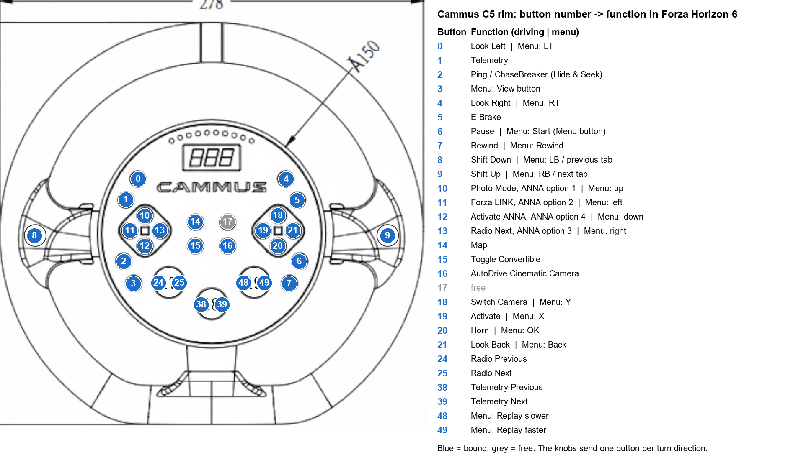

# Cammus C5 + CP5 in Forza Horizon 6 (Steam, PC)

A working setup for the Cammus C5 direct-drive base in Forza Horizon 6: force feedback, the
C5 rim's buttons and the CP5 pedals, and the rim's display and LEDs fed by telemetry. Tested
2026-10-23 with FH6 build 461691 (6.461, Steam) on Windows 11.

**Why** each part is needed: [docs/how-it-works.md](docs/how-it-works.md).

> **Disclaimer.** The setup installs a DLL that hooks into the game process and modifies game
> files. FH6 ships no anti-cheat files, but that is no guarantee for online play. Use at your
> own risk; everything can be undone (see [Undo](#undo)).

> **After every FH6 update, and after Steam's "Verify integrity of game files": run
> `install.ps1` again.** Both restore the game's files, which removes the profile and its
> label; the DLL stays. After an **update**, delete the old backups first (see
> [After an update](#after-an-fh6-update-or-verify-integrity-of-game-files)).

## Hardware

The wheel runs in Cammus **separate mode**: three USB HID game controllers. The pedals hang
off the base and are only detected when the base powers up, so they cannot be plugged in
later.

| Device | VID/PID | Role |
|---|---|---|
| CAMMUS C5 Wheel Base | `0x34160301` | steering axis 0, the FFB motor; also a serial port the Cammus app uses for the rim display |
| CAMMUS C5 Steering Wheel (rim) | `0x34161021` | all buttons and knobs, see [button map](#button-map) |
| CAMMUS CP5 Pedals | `0x34161018` | gas axis 0, brake axis 1, clutch axis 2 |

Another Cammus base has another PID; the profile is written for these IDs.

## What gets installed

| # | Part | Where | Needed for |
|---|---|---|---|
| 1 | `xinput1_3.dll` proxy | FH6 game folder | FFB at all: stops the crash in Windows' `pid.dll`, switches the motor on |
| 2 | Mapping profile in the **Logitech G29 slot** | `media\inputmappingprofiles.zip` | FH6 using the base for FFB although the pedals are "Device 1"; the button layout |
| 3 | Profile label "CammusC5CP5" | `media\Stripped\StringTables\EN.zip`, `DE.zip` | cosmetic: the name shown instead of "Logitech G29" |

Then two things are set by hand: the in-game settings and the Cammus app (below).

## Install

1. Download `fh6-cammus-c5-<version>.zip` from the
   [latest release](https://github.com/d4g/fh6-cammus-c5/releases/latest) and extract it.
   The `.sha256` file next to it holds the zip's checksum
   (`Get-FileHash fh6-cammus-c5-<version>.zip` must show the same value).
2. Close FH6.
3. Run, in the extracted folder:

   ```powershell
   powershell -NoProfile -ExecutionPolicy Bypass -File install.ps1
   ```

   It needs only Windows PowerShell 5.1. If FH6 is not in Steam's default library, add
   `-GameDir "D:\SteamLibrary\steamapps\common\ForzaHorizon6"` (or set the environment
   variable `FH6_DIR`). Untouched copies of the changed game files go to
   `%USERPROFILE%\fh6-backup` (`-BackupDir` or `FH6_BACKUP_DIR` to change); the script only
   backs up files that are still original and refuses otherwise.
   Other options: `-Label` (at most 12 bytes), `-Languages` (string tables for the label,
   default `EN, DE`), `-SkipDll`, `-SkipProfile`, `-SkipLabel`.
4. Make the in-game settings and the Cammus settings below.

Do **not** remap buttons inside FH6 on this profile: changes to a default profile are not
saved (they are gone after a restart), and saving them as a custom profile sends FFB to
"Device 1", the pedals. Change the layout in the source instead ([Development](#development)).

## In-game settings

**Settings → Advanced Controls (force feedback):**

| Setting | Value | Note |
|---|---|---|
| **Invert Force Feedback** | **On** | required: without it the wheel swings up lock to lock. Cammus's own FH5 guide prescribes the same |
| Force Feedback Scale | ~1.0 | starting values from community guides for direct drive, not tuned for the C5; adjust one at a time |
| Center Spring Scale | ~0.4 | |
| Wheel Damper Scale | ~0.3 | raise if the wheel gets restless |
| Mechanical Trail Scale | ~1.0 | |
| Vibration Scale | ~0.5 | first lever if there is too much vibration |
| Road Feel Scale | ~0.6 | second lever against vibration |
| Steering axis deadzone inside / outside | 0 / 100 | |
| Steering Linearity | 50 | linear |

**Settings → Difficulty → Steering: Simulation.**
The rotation range is not set in the game on PC; set it in the Cammus app (900° is the usual
starting point).

**Settings → HUD and Gameplay → Data Out:** On, IP `127.0.0.1`, **port `20779`** (the port the
Cammus app listens on while FH6 runs). FH6 sends only while driving.

**Controls → Wheel → Layout: CammusC5CP5.**

## Cammus app

- Keep it **running**: it receives FH6's telemetry and drives the rim's display and LEDs. It
  detects FH6, listens on `127.0.0.1:20779` and uses its FH5 telemetry code for it; FH6's
  packet has the same 324-byte format, no conversion is needed.
- **FFB Invert: off** (the game's Invert Force Feedback does it; both on would cancel out).
- Damping / friction / inertia: low. FH6 damps by itself, and base-side damping hides detail.
- **Not needed:** the app's Forza / Horizon helper mode and Cammus's `horizonHelper` (a vJoy
  relay written for an older base). Keep the helper mode off and start FH6 directly through
  Steam: the helper mode is built to write Cammus's own versions of the game's profile zips,
  which would undo part 2.
- Windows' "preferred device" in `joy.cpl` makes no difference to FH6 (FH6 orders devices by
  Windows.Gaming.Input, where the pedals come first).

## Button map



German version: [c5-button-map.de.png](docs/images/c5-button-map.de.png). Numbers are the rim's button
indices as Windows.Gaming.Input reports them; FH6's own menu counts from 1 ("Device 3:
Button 6" is button 5). The knobs send one button per click direction (17: 24/25,
18: 38/39, 19: 48/49).

Layout in short: paddles shift while driving and switch menu tabs; left D-pad = menu
navigation / photo mode, Forza LINK, ANNA, radio; right D-pad = A/B/X/Y in Xbox positions
(down OK, right back, left X, up Y) and horn, look back, activate, camera while driving;
7 rewind; 5 handbrake; 6 pause; 1 telemetry overlay, knob 18 its pages (only while it is
open); knob 17 radio; 15 convertible top; 14 map; 2 Hide & Seek ping.

Rewind screen: 20 resume from here, 7 rewind farther, 21 cancel (FH6's rewind has no
forward/back scrubbing).

## After an FH6 update or "Verify integrity of game files"

Both restore the game's zips and string tables, which removes parts 2 and 3. The DLL is not a
game file and stays.

- **After "Verify integrity of game files":** run `install.ps1` again.
- **After an FH6 update:** delete the old copies in `%USERPROFILE%\fh6-backup` (or your
  `-BackupDir`) first, since they belong to the previous version, then run `install.ps1`; it
  backs up the new originals. If the update changed a file in a way the script does not
  expect, it stops with a message before changing that file.

Check that the DLL still patches: `%TEMP%\fh6-ffb-fix.log` should start with
`patched pid.dll …` after a game start.

## Undo

```powershell
powershell -NoProfile -ExecutionPolicy Bypass -File uninstall.ps1
```

Restores the backed-up game files and removes the DLL (same `-GameDir` / `-BackupDir` options
as `install.ps1`). Steam's "Verify integrity of game files" restores the game files too, but
leaves the DLL.

## Development

Everything below is for changing the setup; installing does not need it.

- **DLL:** source, build and switches in [dll/](dll/README.md)
  (Rust, GNU toolchain `stable-x86_64-pc-windows-gnu`, no Visual Studio). `install.ps1` takes the DLL from
  next to itself or from `dll\target\release`.
- **Layout:** defined as a table in [scripts/build_profile.py](scripts/build_profile.py), which
  generates [profile/DefaultRawGameControllerMappingProfileCammusC5.xml](profile/DefaultRawGameControllerMappingProfileCammusC5.xml);
  do not edit the XML by hand. All commands FH6 knows, with the contexts they belong in, are
  in [docs/fh6-input-commands.md](docs/fh6-input-commands.md).
- **Tools** in [scripts/](scripts) (Python ones run with [uv](https://docs.astral.sh/uv/) from
  the repository root):

  | Script | Purpose |
  |---|---|
  | `build_profile.py` | binding table → profile XML |
  | `render_button_map.py` | button map images (`--lang en` / `de`), from the drawing and `capture_buttons.csv` |
  | `capture_buttons.ps1` | measure a rim's button numbers (PowerShell); writes `capture_buttons.csv` |
  | `list_input_commands.py` | regenerate `docs/fh6-input-commands.md` from the game's exe and stock profiles (reads `FH6_DIR` / `FH6_BACKUP_DIR` like `install.ps1`) |

  After changing the layout:

  ```powershell
  uv run --no-project python -I scripts\build_profile.py
  uv run --no-project --with pillow python -I scripts\render_button_map.py docs/images/c5-rim-drawing.png docs/images/c5-button-map.png --lang en
  uv run --no-project --with pillow python -I scripts\render_button_map.py docs/images/c5-rim-drawing.png docs/images/c5-button-map.de.png --lang de
  powershell -NoProfile -ExecutionPolicy Bypass -File install.ps1 -SkipDll -SkipLabel
  ```

## License

[The Unlicense](LICENSE): public domain, no rights reserved, no warranty. It covers the code,
the profile and the documentation of this project. It does not cover third-party material:
the rim drawing `docs/images/c5-rim-drawing.png` (and the button maps drawn on top of it) is an
AI-made redrawing of Cammus's product drawing; "Forza Horizon", "Cammus" and the other product
names belong to their owners.
